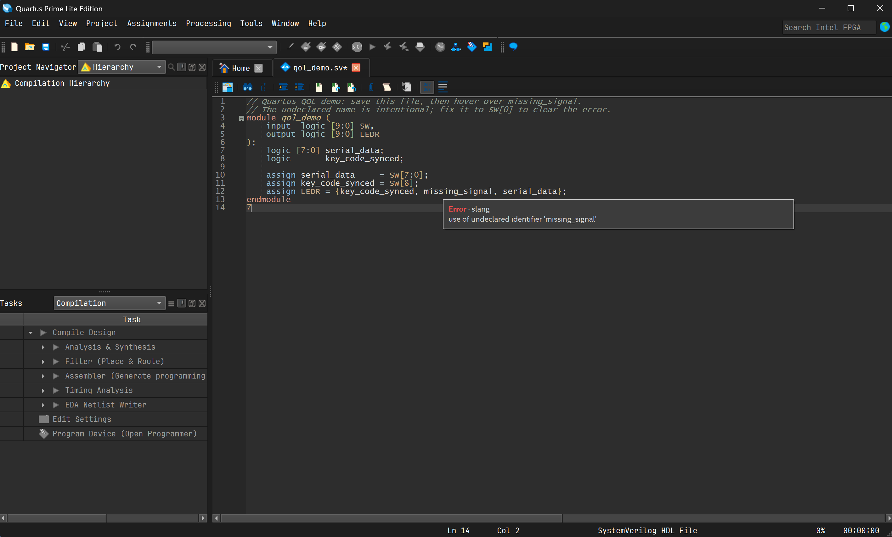
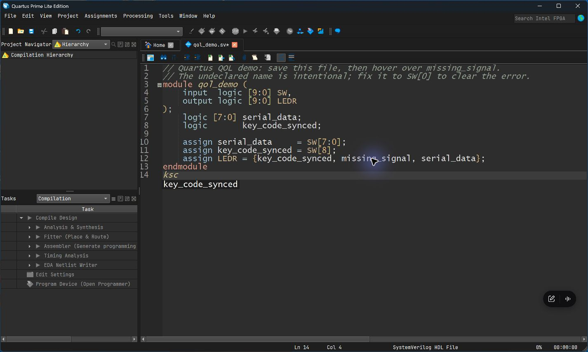
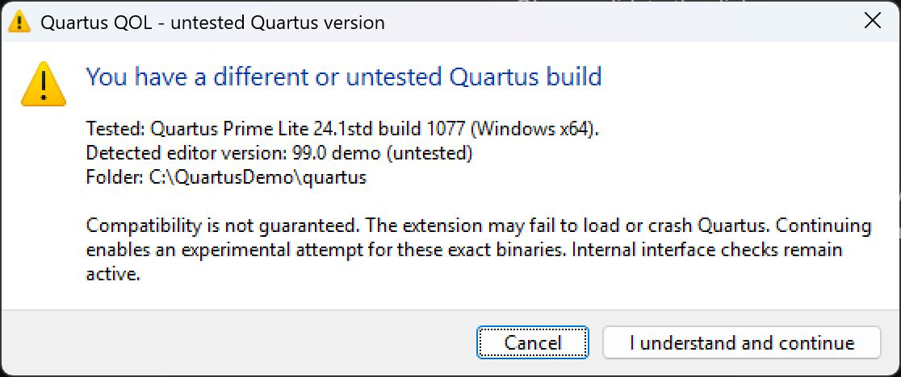

# Quartus QOL

Quartus's editor sucks, so I made this. It adds these to the editor already in Quartus:

- Error checking after save, with squiggles and hover messages.
- Formatting on save.
- Autocomplete for keywords and names in your file. It matches parts of names and ignores case.
- Syntax colors and dark themes for the editor, menus and panels.

[Download the latest release](https://github.com/CatOtchi/quartus-qol/releases/latest), close Quartus and run `Install.cmd`. Settings are in **Tools → Options**.

You need Quartus and an internet connection to install it. The installer downloads Slang, Verible, Python and Node for you. You don't need VS Code or any of those tools installed beforehand. Once installed, it works offline.

I've tested it on Windows x64 with Quartus Prime Lite 24.1std build 1077. On a different build, the installer shows a warning. You can cancel or click **I understand and continue**, but I can't guarantee it'll work. And I know one of you is going to ask, Linux isn't supported yet... (might work on it in the future tho).

The screenshots use the Quartus Dark editor preset. A fresh install starts defaults to the Quartus (light) theme as its what people are used to as it uses the usual Quartus colors plus extra colors for ports and nested blocks.

## Install

1. Download the Windows ZIP from [the latest release](https://github.com/CatOtchi/quartus-qol/releases/latest) and extract it.
2. Close Quartus and run `Install.cmd`.
3. If the installer can't find Quartus, select its installation folder. It then downloads the tools it needs. Approve the admin prompt if Windows asks for permission to add the startup hook.
4. Open Quartus, open a `.sv` or `.v` file and save it.

The installer puts everything in `%LOCALAPPDATA%\QuartusQOL`, so you can delete the folder you downloaded afterwards. It downloads each tool from its own release page so no need to worry about having dependencies installed before hand :)

## What it adds

- Slang checks your code after you save it rather than only after compile. Errors get red squiggles, warnings get orange and notes get blue. Hover over a marked line to read the messages (similar to every other IDE). If a line has several messages, they appear in one tooltip.
- Verible formats on save. The defaults are four spaces, 120 columns, and aligned ports, declarations and assignments. You can change these by editing the verible config found at `%LOCALAPPDATA%\QuartusQOL\user\config.tcl`. If its not there create the file and edit it. 
- Autocomplete suggests names from the current file and common HDL keywords. Matching ignores case and accepts parts of names or letters in order. For example, `data` finds `serial_data`, `ksc` finds `key_code_synced`, and `ledr` finds `LEDR`. Use the arrow keys to select a suggestion, Tab or Enter to accept it, and Escape to close the list.
- Syntax colors distinguish ports, module names and other code roles. Nested brackets and blocks have matching colors. You can pick a preset or turn this off.
- Pin Planner can use the editor's palette for its assignment rows. This is off by default.

Try [the demo file](demo/qol_demo.sv) if you want to see it working. `missing_signal` is deliberately wrong so there's an error to hover over.

## Colors and settings

Go to **Tools → Options → Text Editor → Colors** to pick an editor theme:

- Quartus (light) is the default. It has a white background and familiar Quartus colors, with extra colors for the added syntax roles.
- Quartus Dark is the grey palette in my screenshots and the original QOL setup.
- Catppuccin Frappé is dark.
- Nord is dark.
- Tokyo Night is dark.
- Catppuccin Latte is light.
- Tokyo Night Day is light.

Dark themes now change the menus, toolbars and standard panels too, so you don't need Windows set to dark mode to get a dark Quartus. Pick a light theme or turn enhanced colors off to put the UI back how it was before QOL started. Device diagrams and Windows-native dialogs can still keep their own colors. The plugin doesn't change your font (I recommend you download a nerdfont though as it makes editing easier on the eyes)

The other switches are in Options too:

| Where | What |
| --- | --- |
| Text Editor → Autocomplete Text | QOL completion |
| Text Editor → Formatting | Format on save, indentation width and line length |
| Text Editor → Diagnostics | Checking, extra Slang warnings and hover delay |
| Text Editor → Colors | Enhanced colors and the theme preset |
| Pin Planner | Use the editor theme for assignment rows |

Click **OK** to save or **Cancel** to leave things as they were. Turning enhanced colors off gives control back to Quartus's own color settings. Quartus's original autocomplete switches are separate from the QOL switch.

You can change indentation and line length in Formatting now, so no need to edit a file for those. The controls allow 1 to 16 spaces and 40 to 500 columns. Diagnostics has a switch for Slang's extra warnings and a hover delay of 0 to 5000 milliseconds. These changes don't need a restart, and formatting uses the new values on your next save.

For alignment and other tool arguments, use `user/config.tcl`. The settings you save in Options take priority for the controls shown there, but leave your other arguments alone. Custom theme editing isn't included yet, just the presets above.

If you're upgrading from a release before the theme picker, it keeps the original dark palette. New installs get the light Quartus-style default.

## Updating or removing it

To update, close Quartus, download a newer ZIP and run its `Install.cmd` again. If you cloned the repo, run `git pull` and rerun the installer. The installer keeps your settings and selected theme.

To uninstall, close Quartus and run `Uninstall.cmd`. It removes the startup hook but keeps your settings and downloaded tools. Delete `%LOCALAPPDATA%\QuartusQOL` afterwards if you want those gone too.

## If something doesn't work

Other Quartus builds may have different internals. Accepting the version warning lets the installer try, but the bridge still checks the interfaces it uses and can refuse to load. It can also crash on an untested build. If Quartus changes, rerun the installer to acknowledge that build.

If nothing starts, check `app/.runtime/startup-error.txt` inside the installed folder. If a download fails, rerun the installer; it keeps verified downloads so you don't need to start over.

Error checking works on saved Verilog and SystemVerilog files. It doesn't check unsaved edits or VHDL. Slang and Quartus synthesis won't always report the same issues. Completion uses words from the file rather than compiler-resolved members or ports. Very large files skip completion or enhanced coloring.

QOL reads project source files, includes, macros and the top module from Quartus where possible. For generated IP or unusual projects, copy `user/config.example.tcl` to `user/config.tcl` in the installed folder and add your paths or overrides there. Restart Quartus after changing it.

This uses undocumented Quartus internals and isn't an official Altera plugin. The installer adds a marked block to `quartus/common/tcl/internal/qui_init.tcl`. It doesn't modify Quartus's DLLs. See [the validation notes](docs/VALIDATION.md) for what I've tested and what still needs testing on a clean machine.

## Source

See the [development notes](docs/DEVELOPMENT.md), [third-party notices](THIRD_PARTY.md) and [MIT licence](LICENSE). Quartus itself isn't included.
